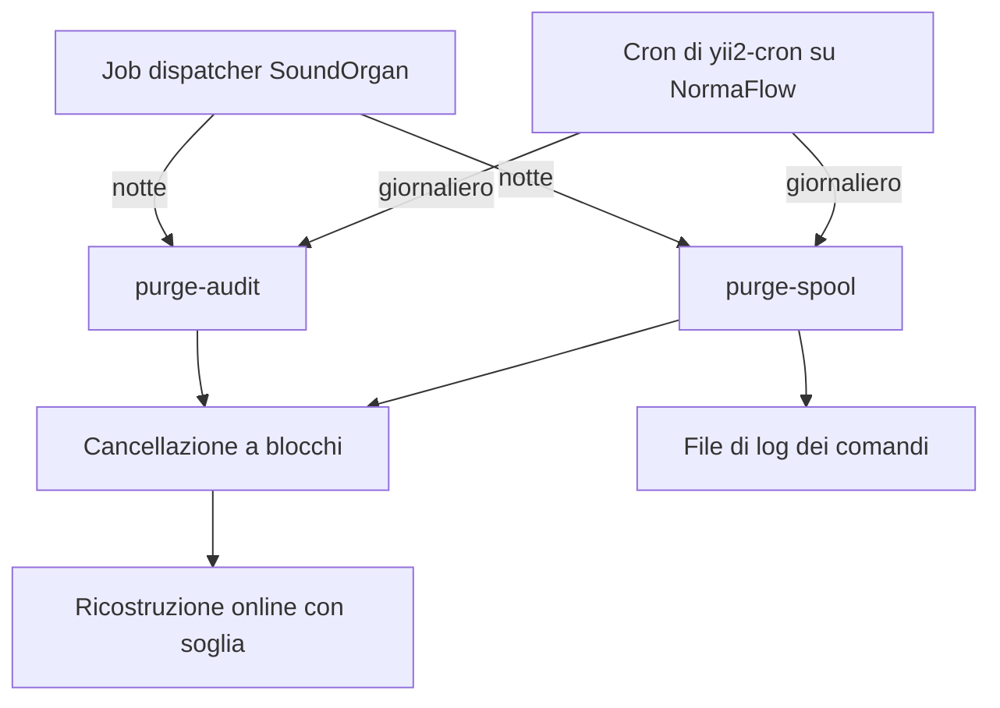
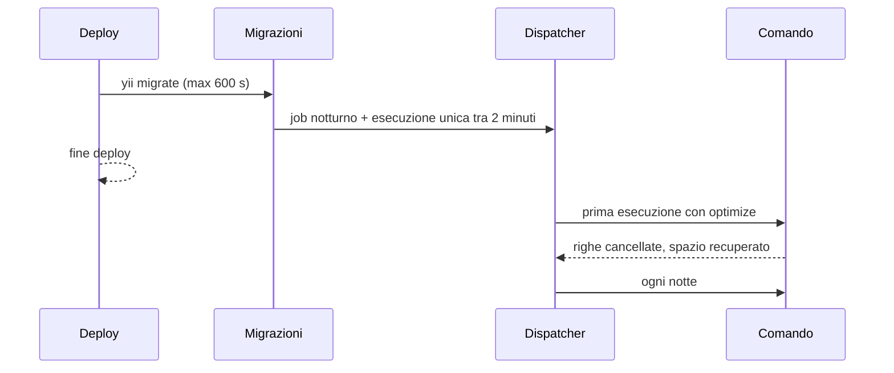

# Retention di intelligence_db_audit e commands_spool — Design

Data: 2026-11-02 · Versione: v2.2.5 (rebuild, non ancora installata)
Pacchetti: `sharkom/intelligence`, `sharkom/yii2-cron`; core SoundOrgan (migrazioni con prefisso di versione).

## Contesto

In ogni istanza SoundOrgan il DB occupa 13-15 GB. Le tabelle più grandi:

| Tabella | Dimensione | Pulizia oggi |
|---|---|---|
| `intelligence_db_audit` | ~7 GB per istanza (28 GB sulle 4) | nessuna |
| `commands_spool` | ~1,9 GB | DELETE a 3 mesi a ogni `cron/cron/run` (ogni minuto) |
| `job_executions` + log dei job | piccola | `CleanupExecutionsJob`, 14 giorni, alle 3:00 |
| `voip_calls` | 1,2-1,3 GB | fuori ambito |

Problemi della pulizia attuale di `commands_spool` (`yii2-cron/commands/CronController.php:160-172`):
- cancella anche righe pendenti o in esecuzione (non filtra `completed`);
- un'unica DELETE senza LIMIT ogni minuto;
- non cancella i file `logs_file` su disco;
- con 3 mesi la tabella non scende: 1,9 GB sono già 3 mesi (`logs` ~540 MB/mese).

In `intelligence_db_audit` lo spazio è concentrato su poche tabelle auditate (dev: `quotations_renders_prospects` 2,8 GB, `commands_spool` 1,7 GB — non più auditata dal 30/10, `quotations_renders` 0,6 GB). I rollback dell'audit usano una sola riga per volta: cancellare le righe vecchie toglie solo la possibilità di ripristinare quegli eventi.

Con `innodb_file_per_table=ON` lo spazio cancellato resta nel file della tabella (riusato) finché la tabella non viene ricostruita.

## Decisioni

- `intelligence_db_audit`: retention **30 giorni**.
- `commands_spool`: retention **14 giorni** (come lo storico del dispatcher).
- `job_executions` e log dei job: invariati (14 giorni, `CleanupExecutionsJob`).
- `voip_calls`: nessun intervento.
- Recupero dello spazio con ricostruzione online della tabella, automatico con soglia.
- Prima esecuzione con ottimizzazione subito dopo il deploy, **fuori** dalle migrazioni (il deploy ha 600 s per tutte le migrazioni).
- Tutto nella v2.2.5, insieme alla correzione della regressione dei trigger su tabelle escluse dall'audit (trigger "Errore Cron").

## Componenti

Ogni pulizia è un comando console nel pacchetto proprietario della tabella, così funziona anche sul core NormaFlow (che ha yii2-cron ma non il job dispatcher).

- `sharkom/intelligence`: `php yii intelligence/maintenance/purge-audit [--days=30] [--optimize=1] [--max-seconds=1200]`
- `sharkom/yii2-cron`: `php yii cron/maintenance/purge-spool [--days=14] [--optimize=1] [--max-seconds=1200]`
- Logica in un servizio per pacchetto (controller sottili), con una parte comune per cancellazione a blocchi e ottimizzazione duplicata nei due pacchetti solo se non c'è un posto comune adatto (yii2-dev-helper è dipendenza di entrambi: preferito).

## Cancellazione

- A blocchi di 5.000 righe per id (`DELETE ... WHERE id IN (...)` dopo una SELECT degli id più vecchi della soglia, sull'indice della data), con pausa breve tra i blocchi.
- Tempo massimo per esecuzione (default 20 minuti): il resto la notte dopo.
- `intelligence_db_audit`: per `date < NOW() - INTERVAL N DAY` (indice su `date`).
- `commands_spool`: per `created_at < NOW() - INTERVAL N DAY` **e** `completed <> 0` (mai righe pendenti o in esecuzione). Righe con `created_at NULL` concluse: cancellate. Per ogni riga cancellata si elimina anche il file `logs_file`, se esiste ed è dentro la cartella dei log attesa.
- DELETE SQL diretta: nessun evento ActiveRecord, quindi né trigger né audit.
- Log finale: righe cancellate, file rimossi, blocchi, durata, spazio recuperato.

## Recupero dello spazio

Dopo la cancellazione, se `--optimize`:
- `ALTER TABLE <t> FORCE, ALGORITHM=INPLACE, LOCK=NONE`: online, rifiuta di partire piuttosto che bloccare la tabella;
- `SET SESSION lock_wait_timeout = 10` sulla connessione: se il blocco breve iniziale/finale non arriva entro 10 s rinuncia (warning) e riprova alla prossima esecuzione, senza mettere in coda le query dell'applicazione;
- solo se `data_free` > 1 GB **e** > 30% di `data_length + index_length`;
- solo se lo spazio libero sul filesystem del datadir non è verificabile o è superiore ai dati residui della tabella più un margine. (Il DB è in un altro container: se non si può verificare, si registra un warning e si procede solo se i dati residui sono sotto una soglia prudente, es. 2 GB.)

## Programmazione

SoundOrgan (migrazioni nei pacchetti, copiate nel core con prefisso `v2_2_5`, guardia `jobDispatcherAvailable()` come `m261029_100500_v2_2_3_schedule_sign_reconcile`):
- system job "Manutenzione: pulizia audit intelligence" (`console.run`, route `intelligence/maintenance/purge-audit`, args `--optimize=1`), DAILY alle 2:30, overlap skip, timeout 1800 s;
- system job "Manutenzione: pulizia commands_spool" (route `cron/maintenance/purge-spool`), DAILY alle 2:45;
- per ciascuno, una schedule unica (`COUNT=1`) con dtstart = momento della migrazione + 2 minuti: prima pulizia con ottimizzazione subito dopo il deploy. Se il dispatcher la considera "persa" va verificato il `catch_up_threshold_seconds`.
- idempotenti sul nome del job; safeDown che li rimuove.

NormaFlow (nessun dispatcher): le stesse migrazioni, se la tabella dei cron_job di yii2-cron esiste, registrano un cron_job giornaliero (`30 2 * * *` / `45 2 * * *`).

## commands_spool: pulizia attuale

- `CronController::purgeLogs()` e la sua chiamata in `actionRun` vengono rimossi.
- Il parametro di modulo `purge_log_interval` (mesi) è sostituito da `purge_spool_days` (giorni, default 14); se è impostato solo il vecchio parametro, viene convertito (mesi × 30) con un warning di deprecazione.
- `SpoolerController::actionCleanup` (non schedulato) resta, documentato come alternativa manuale.

## Regressione trigger (stesso rilascio)

Dal commit ce2faa6 di intelligence la lista delle tabelle escluse dall'audit blocca anche la valutazione dei trigger: il trigger 14 ("Errore Cron", `commands_spool.result='error'`) non scatta più. Correzione: le esclusioni valgono solo per l'audit; per i trigger restano escluse solo `intelligence_db_audit` e `intelligence_triggers`.

## Test

- Comandi: retention per giorni; righe pendenti/in esecuzione di `commands_spool` mai cancellate; file di log rimossi solo dentro la cartella attesa; blocchi e tempo massimo; soglie dell'ottimizzazione (sotto soglia nessun ALTER; lock non ottenuto → warning, nessun errore).
- Migrazioni: con dispatcher (job notturno + esecuzione unica, idempotenti), senza dispatcher con yii2-cron (cron_job), senza nessuno dei due (nessuna azione, nessun errore).
- Tutto su `soundorgan_test`, mai sul DB dev.

## Dopo il deploy

- Verificare nei log del dispatcher l'esecuzione unica: righe cancellate, ALTER eseguito o rinviato.
- Controllare la dimensione delle tabelle (`information_schema.tables`) e lo spazio del volume MariaDB.

## Fuori ambito (prossima versione)

- Escludere dall'audit i render HTML (`quotations_renders`, `quotations_renders_prospects`) o salvarne solo un riassunto.
- Rollback dell'audit che confrontano tipi di evento sbagliati (già annotato).
- `voip_calls`.
